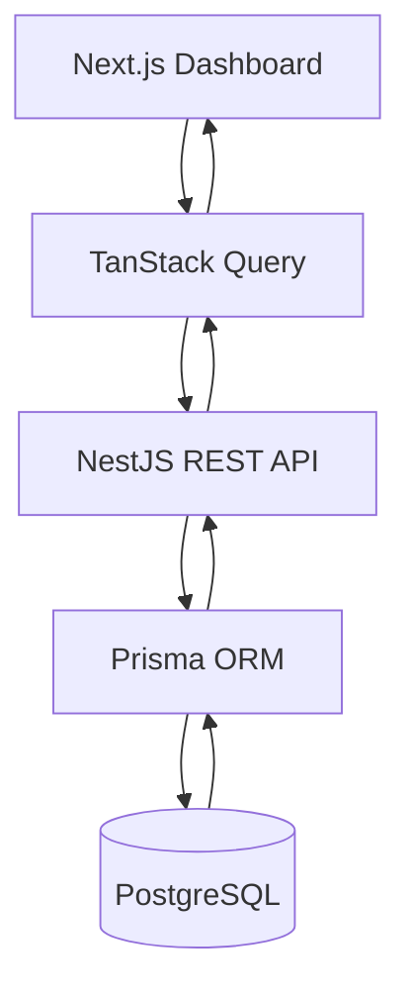

<div align="center">

# 📊 Injection Analytics

### Industrial Production Analytics — Full-Stack Technical Prototype

**Turning simulated manufacturing data into clear, actionable insights.**

[](https://nextjs.org/)
[](https://nestjs.com/)
[](https://www.typescriptlang.org/)
[](https://www.postgresql.org/)
[](https://www.prisma.io/)

[**Live Deployment**](https://injection-analytics.vercel.app) · [**GitHub Repository**](https://github.com/yashfar/injection-analytics)

</div>

---

## ✨ Project Overview

**Injection Analytics** is a full-stack industrial production analytics prototype designed to demonstrate how manufacturing data can be organized, processed, and visualized through a modern web application.

The project combines a **Next.js dashboard**, a **NestJS REST API**, and a **PostgreSQL database managed with Prisma**.

Its main objective is to turn production-related data into accessible visual insights through interactive charts, filters, and responsive interfaces.

> **Important:** This is a technical proof of concept using simulated manufacturing data. It is not connected to live industrial machinery or production systems.

---

## 🚀 Key Features

### Interactive Analytics Dashboard
- Responsive dashboard interfaces for production analytics.
- Data visualization using Recharts.
- Interactive charts for exploring manufacturing-related information.
- Filtering capabilities for analyzing different data views.

### Backend & Data Management
- REST API development with NestJS.
- PostgreSQL data storage and Prisma-based data modeling.
- Separation of frontend presentation and backend data processing.

### Frontend Experience
- Built with Next.js and TypeScript.
- API integration using TanStack Query.
- Loading, empty-data, and error states.
- Reusable UI components and responsive layouts.

### Technical Prototype
- Uses simulated production data.
- Demonstrates a full-stack approach to industrial analytics.
- Designed as a foundation for exploring data visualization and API-driven dashboard architecture.

---

## 🏗️ Architecture

The application separates the analytics interface, API layer, and data storage.



### Project Structure

```text
injection-analytics/
│
├── frontend_next/     # Next.js frontend and analytics UI
│
├── backend_nest/      # NestJS API and backend logic
│
├── .gitignore
│
└── README.md          # Project documentation
```

---

## 🛠️ Technology Stack

| Layer | Technologies |
|---|---|
| Frontend | Next.js, React, TypeScript |
| Backend | NestJS, Node.js, REST APIs |
| Database | PostgreSQL |
| ORM | Prisma |
| Data Fetching | TanStack Query |
| Visualization | Recharts |

---

## 💻 Local Development

The project contains two separate applications:

- `backend_nest` — NestJS REST API
- `frontend_next` — Next.js analytics dashboard

### 1. Clone the repository

```bash
git clone https://github.com/yashfar/injection-analytics.git
cd injection-analytics
```

### 2. Set up the Backend

Open a terminal:

```bash
cd backend_nest
npm install
```

Configure the PostgreSQL database connection and the environment variables required by the backend application.

The `postinstall` script automatically runs `prisma generate`.

Start the NestJS development server:

```bash
npm run start:dev
```

### 3. Set up the Frontend

Open a second terminal from the repository root:

```bash
cd frontend_next
npm install
```

Configure the frontend environment variables required to connect to the backend API.

Start the Next.js development server:

```bash
npm run dev
```

### 4. Build and Test

**Backend:**

```bash
cd backend_nest
npm run build
npm test
```

**Frontend:**

```bash
cd frontend_next
npm run build
npm run test:run
```

### Important Notes

- PostgreSQL must be configured before using database-dependent backend features.
- The frontend and backend are separate applications.
- Exact environment variable names depend on the application configuration.
- The project uses simulated manufacturing data and does not connect to live industrial machinery.


### 1. Clone the repository

```bash
git clone https://github.com/yashfar/injection-analytics.git
cd injection-analytics
```

### 2. Install backend dependencies

```bash
cd backend_nest
npm install
```

### 3. Install frontend dependencies

Open another terminal:

```bash
cd frontend_next
npm install
```

### 4. Configure and start the applications

Configure the required database connection and environment variables according to each application's configuration.

Use the development scripts defined in the respective `package.json` files.

```bash
npm run
```

The exact startup commands and environment variables should be confirmed from the project configuration before running locally.

---

## 📈 What This Project Demonstrates

This project reflects practical experience in:

- Designing and implementing full-stack web applications.
- Developing REST APIs with NestJS.
- Modeling relational data with PostgreSQL and Prisma.
- Integrating frontend applications with backend services.
- Creating interactive dashboards with modern visualization tools.
- Handling asynchronous data, loading states, and errors.
- Organizing a project with separate frontend and backend applications.

---

## ⚠️ Project Scope

Injection Analytics is an independently developed **technical prototype**.

The manufacturing data used for the dashboard is simulated. The application is intended to demonstrate architecture, implementation, and visualization capabilities rather than serve as a production-ready industrial monitoring system.

There is no live connection to factory machinery.

---

## 👨‍💻 Developer

**Yashar Farhadi**  
Full-Stack Developer

[](https://github.com/yashfar)
[](https://www.linkedin.com/in/yashar-farhadi/)
[](https://creativeaventus.com)

---

<div align="center">

**Built to explore the intersection of full-stack development, data visualization, and industrial analytics.**

</div>
